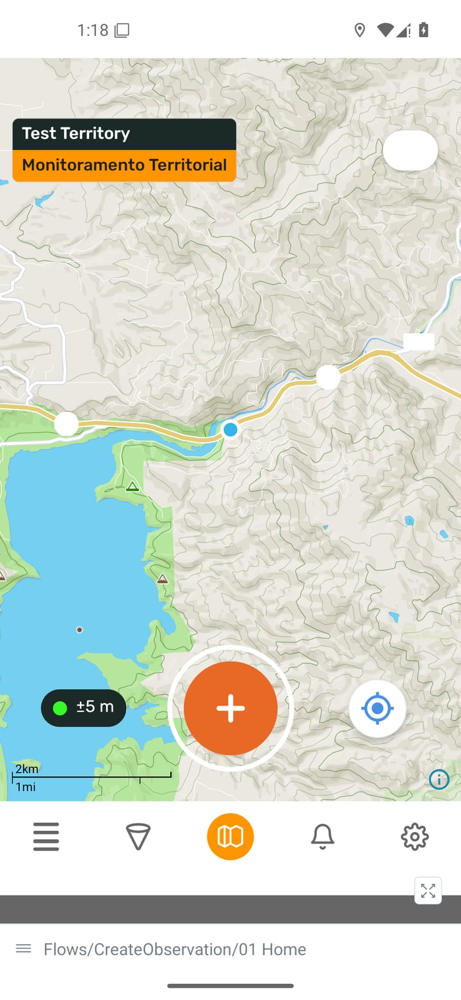
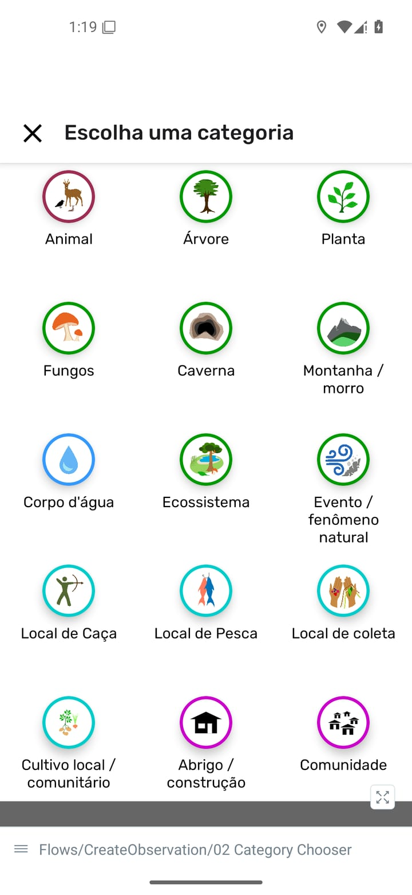
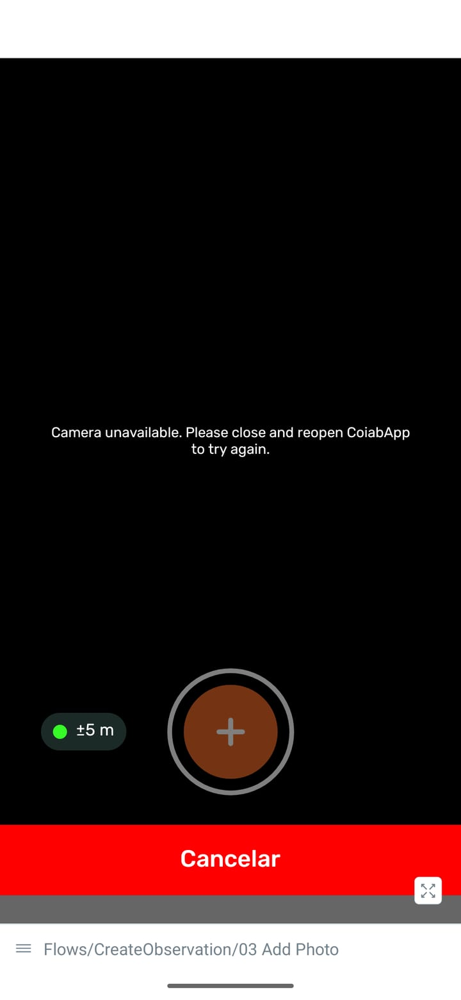
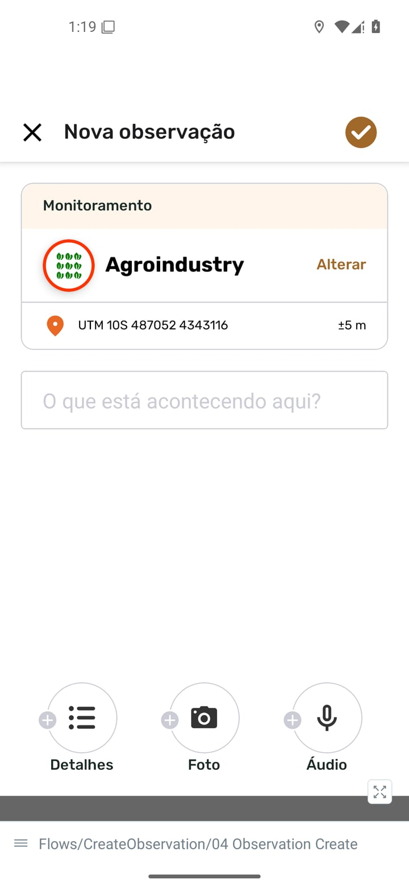
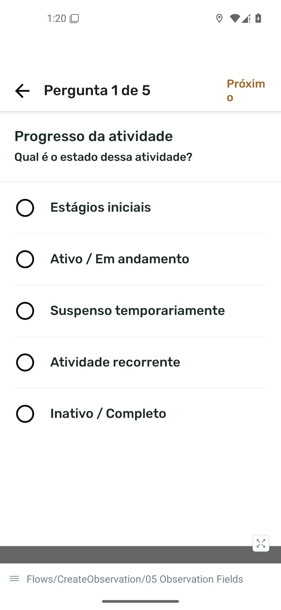
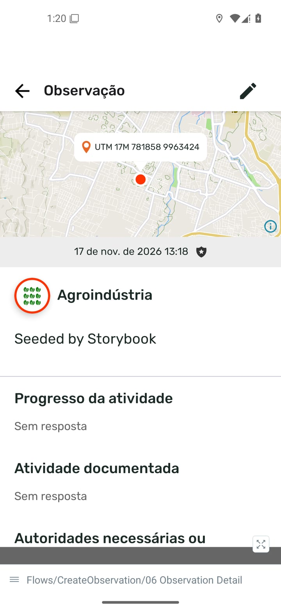

Uma observação é um ponto no território com categoria, data e hora. Ela pode
levar foto, áudio, uma descrição e as respostas dos campos da categoria. É assim
que se registra o que foi visto em campo, mesmo sem internet.

## Passo a passo

### Passo 1 — Home e mapa

Na Home, o mapa abre na área em uso. Toque no botão **+** para iniciar uma nova
observação.

### Passo 2 — Escolher a categoria

Toque na categoria que descreve o que você viu. As categorias vêm do pacote do
território e podem variar conforme a área: **Monitoramento Territorial** e **Alertas**
têm conjuntos diferentes.

:::caution[⚠️ Atenção]
Sem permissão de localização, o mapa não marca o ponto da observação. Se o
pedido aparecer, permita o acesso; a permissão também pode ser liberada nas
configurações do aparelho.
:::

### Passo 3 — Adicionar foto

Toque em **Foto** para abrir a câmera. Enquadre o que quer registrar e confirme a
captura; a foto fica anexada à observação. **Cancelar** volta sem tirar a foto.

### Passo 4 — Preencher a observação

Confira a categoria e a área no topo. O GPS mostra as coordenadas e a precisão. No
campo **O que está acontecendo aqui?**, escreva uma descrição curta. Use
**Detalhes** para responder os campos da categoria, **Foto** para anexar uma
imagem e **Áudio** para gravar um comentário.

### Passo 5 — Responder os campos

Em **Detalhes**, responda uma pergunta por vez. O cabeçalho mostra **Pergunta 1
de 5**; use **Próximo** para avançar e **Concluído** na última pergunta.
**Concluído** apenas volta ao formulário: para salvar a observação, toque no
**✓** no canto superior direito. O **X** abre a confirmação para descartar o
rascunho.

:::tip[💡 Dica]
Os campos mudam com a categoria. Responda apenas os que aparecerem — não é
preciso preencher tudo para salvar.
:::

### Passo 6 — Observação salva

Ao salvar, o app volta ao mapa. A observação aparece no ponto registrado e também
no Paneiro; toque nela para abrir o detalhe com data, categoria, respostas, foto
e localização.

:::note[ℹ️ Nota]
Se não houver sinal de GPS, o app oferece **Salvar** sem localização, **Inserir
manualmente** as coordenadas ou **Continuar aguardando**. Sem coordenadas, a
observação fica salva, mas não ganha um ponto no mapa.
:::

## Veja também

- [Primeiros passos](../primeiros-passos/) — prepare o dispositivo antes do
  primeiro registro.
- [Organização](../organizacao/) — entenda as áreas Monitoramento e Alertas.
