Uma organização — chamada de "território" nas telas — agrupa os projetos de um
mesmo território. Ao criar uma, o app prepara automaticamente as áreas
**Monitoramento Territorial** e **Alertas**, cada uma com suas categorias. Esta
página mostra o caminho principal, do provisionamento ao convite, e o que fazer
quando a organização não abre.

## Passo a passo

### Passo 1 — Preparando o território

Depois de confirmar a criação, o app prepara o território. Aguarde a preparação
terminar: é neste momento que as áreas e as categorias são criadas no
dispositivo. Quando a preparação termina, toque em **Abrir território**: o app
abre na aba **Menu** e o mapa só aparece ao tocar em **Mapa**, na barra
inferior.

### Passo 2 — Convite recebido

Quando um convite chega, o app abre uma folha sobre a tela atual. Com o convite
completo, você vê **Você recebeu um convite para...** e escolhe **Entrar no
território** ou **Recusar**. Se aparecer o aviso de convite incompleto, peça para
quem convidou enviar novamente.

### Passo 3 — Revisar convite

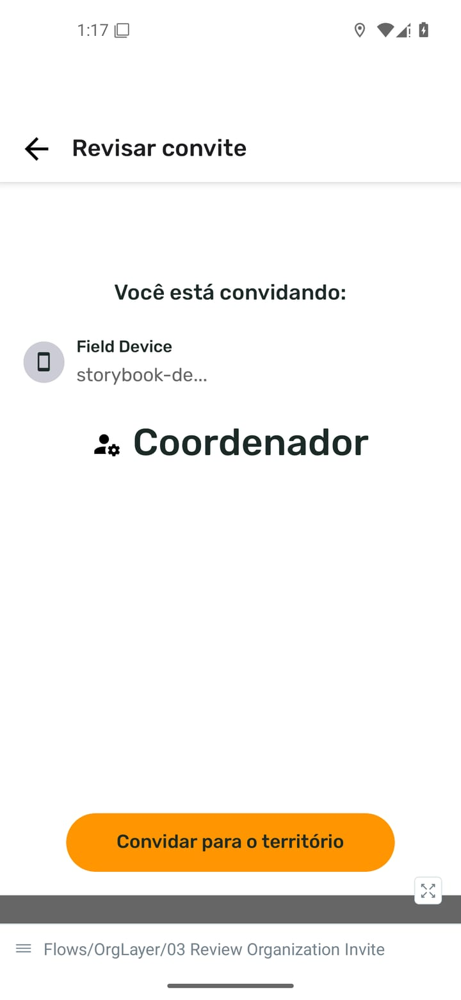

No aparelho de quem convida, a tela **Revisar convite** mostra quem está sendo
convidado e a função. Confira e toque em **Convidar para o território**.

:::caution[⚠️ Atenção]
O convite entre dispositivos exige os dois aparelhos na mesma rede Wi-Fi e na
mesma versão do app. Se um deles estiver em outra rede ou desatualizado, o outro
não aparece na lista.
:::

### Passo 4 — Home com a organização

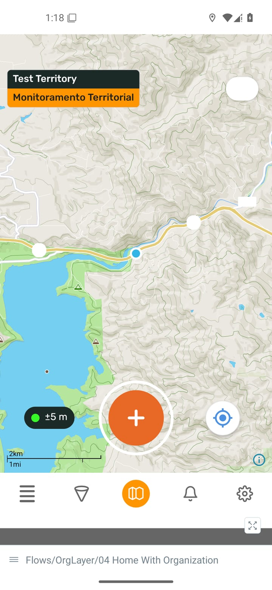

Quando a organização fica pronta, toque em **Mapa** na barra inferior para
abrir o mapa. O cabeçalho mostra o nome do território e a área em uso; a barra
inferior leva a Menu, Paneiro, Mapa, Notificações e Configurações.

### Passo 5 — Seletor de organização

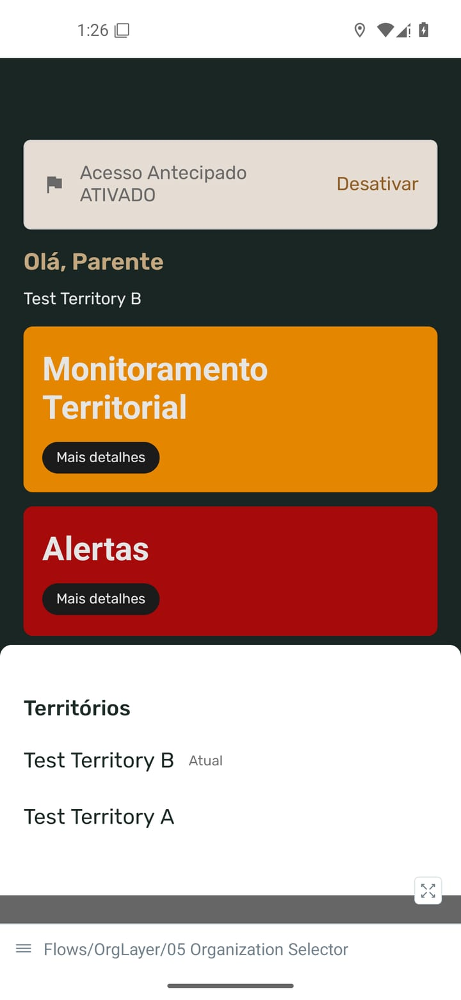

Com duas ou mais organizações, abra **Configurações** e toque em **Trocar de
território**. A folha **Territórios** lista as organizações e marca a que está
aberta com **Atual**. Toque em outra para abri-la.

### Passo 6 — Menu sem entrada de troca

O Menu não tem entrada para trocar de território. Ele mostra a saudação **Olá,
Parente**, o nome do território, os cards **Monitoramento Territorial** e
**Alertas**, **Mapa de fundo** e **Convidar**. A entrada **Convidar** aparece
para quem coordena.

### Passo 7 — Menu com uma organização

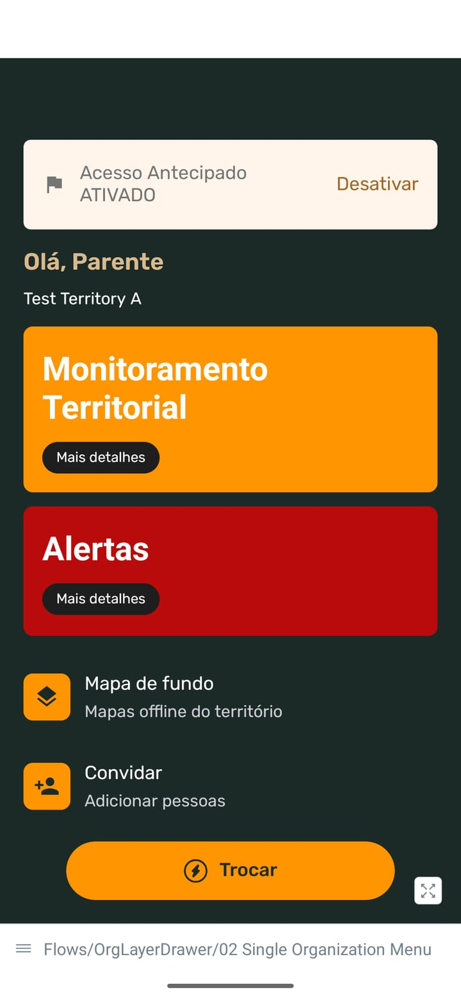

Com uma única organização, a opção **Trocar de território** não aparece em
Configurações. O Menu continua igual, com os dois cards de área.

:::note[ℹ️ Nota]
O seletor **Territórios** só existe quando o dispositivo tem duas ou mais
organizações. Com uma só, não há o que trocar.
:::

### Passo 8 — Criar a segunda organização

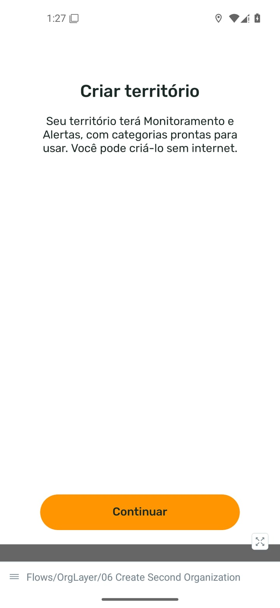

Em **Configurações**, toque em **Criar território** — a entrada aparece para
quem coordena. Leia a introdução e toque em **Continuar**; depois confira o
território selecionado e informe o **Endereço do arquivo remoto** para concluir.

### Passo 9 — Preparando a segunda organização

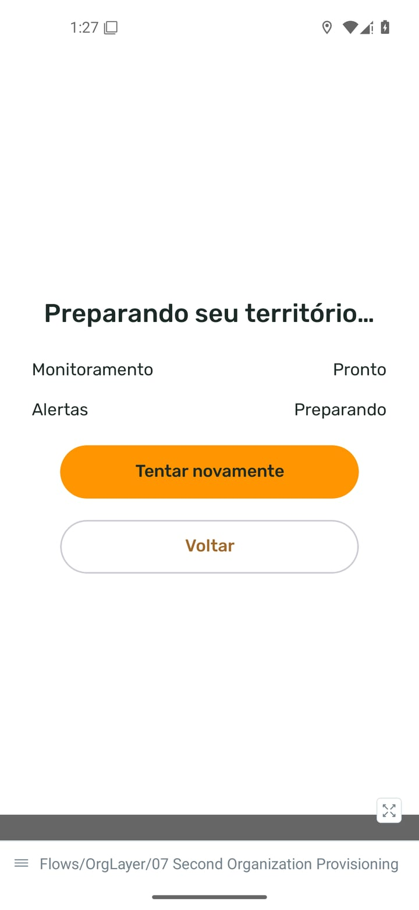

O app prepara a nova organização e mostra o estado de cada área — **Pronto**,
**Preparando**, **Aguardando** ou **Não concluído**. Espere as duas áreas
ficarem prontas antes de abrir o território.

:::caution[⚠️ Atenção]
A introdução diz que o território pode ser criado sem internet, mas a versão
atual exige um **Endereço do arquivo remoto** válido. A verificação é feita na
hora, então é preciso estar conectado para concluir a criação.
:::

### Passo 10 — Trocar para Alertas

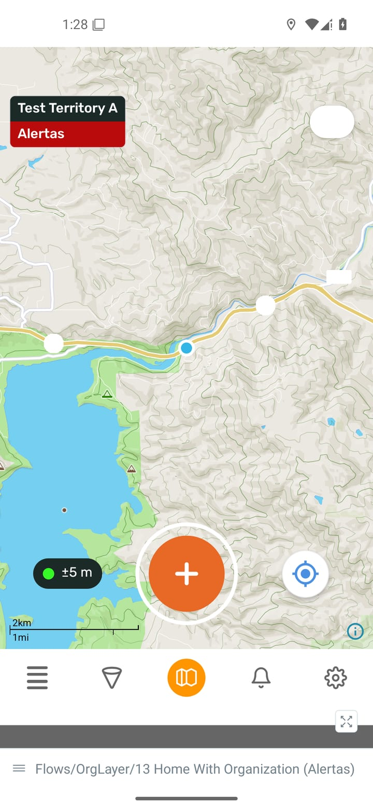

Para mudar de área, volte ao Menu e toque no card **Alertas**. O cabeçalho passa
a mostrar a faixa da área escolhida, e o mapa exibe as observações dela.

:::tip[💡 Dica]
Tocar no card da área em que você já está volta ao mapa sem trocar de área.
:::

### Passo 11 — Nome longo de território

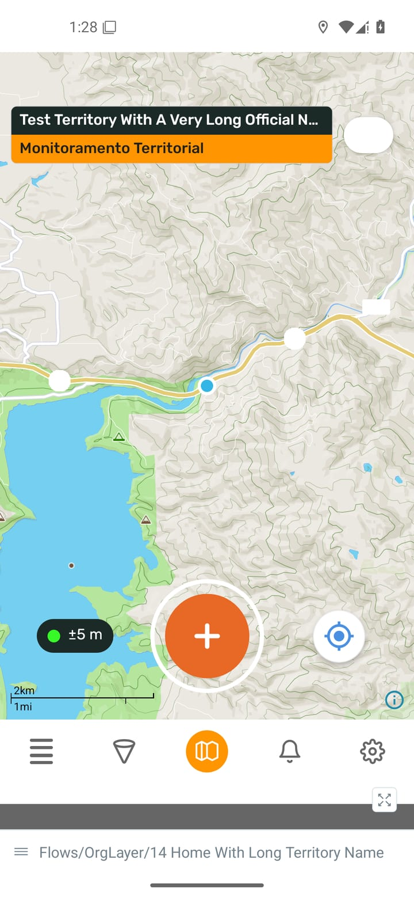

O cabeçalho mostra o nome do território em uma linha só. Nomes longos são
truncados com reticências (**…**) para caber ao lado do ícone; o nome completo
não aparece nesse espaço.

## Se a organização não abrir

Às vezes o território já está preparado, mas o app não consegue abri-lo. A tela
mostra **Não foi possível abrir seu território** e o estado das duas áreas.

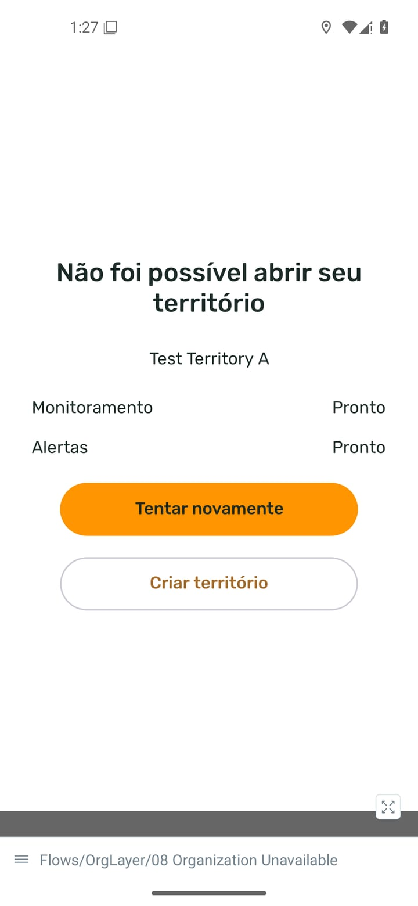

Com uma organização no dispositivo, use **Tentar novamente**. Se o erro
continuar, **Criar território** abre a criação de uma nova organização.

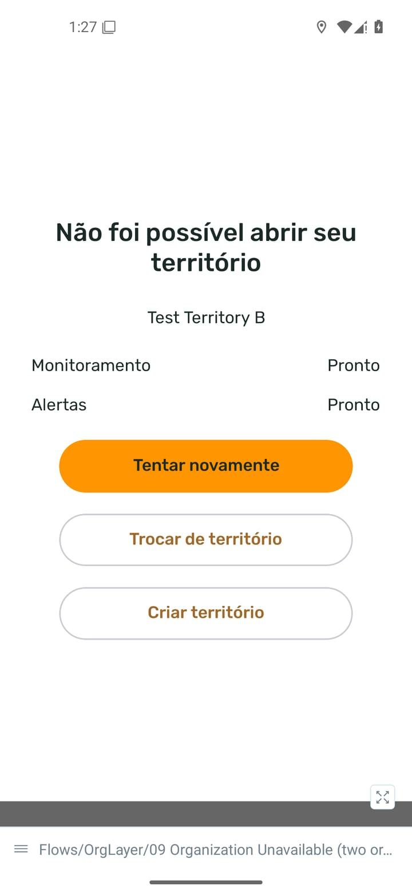

Com duas organizações, além de tentar de novo, você pode tocar em **Trocar de
território** e abrir a outra.

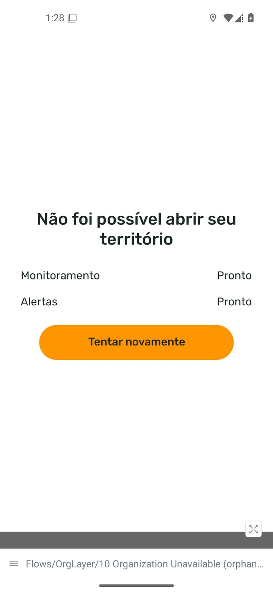

Se a seleção guardada não aponta para nenhum território válido, a tela não mostra
nome nem as opções de troca, e a navegação volta para ela. Use **Tentar
novamente** — é a única ação disponível. Se o erro persistir, o app não oferece
saída: não há como abrir a organização pela tela de Configurações.

## Veja também

- [Primeiros passos](../primeiros-passos/) — como chegar à criação do território.
- [Criar uma observação](../criar-observacao/) — o primeiro registro em uma área.
