Esta é a jornada da primeira abertura do app em um dispositivo novo. Você informa
o nome do aparelho, sua etnia e sua aldeia e, no fim, escolhe entre criar uma
organização ou aguardar um convite.

## Passo a passo

### Passo 1 — Abertura

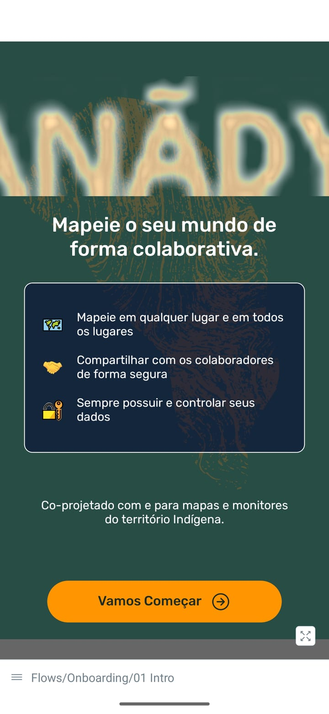

Toque em **Vamos Começar** para sair da apresentação e seguir para a privacidade
dos dados.

### Passo 2 — Privacidade dos dados

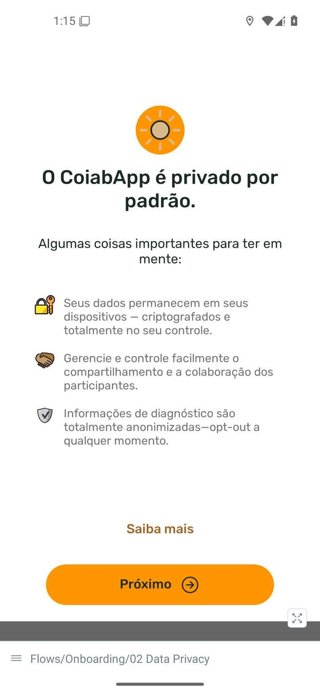

Leia os três pontos sobre onde os dados ficam e toque em **Próximo**. O link
**Saiba mais** abre a política de privacidade completa.

### Passo 3 — Política de privacidade

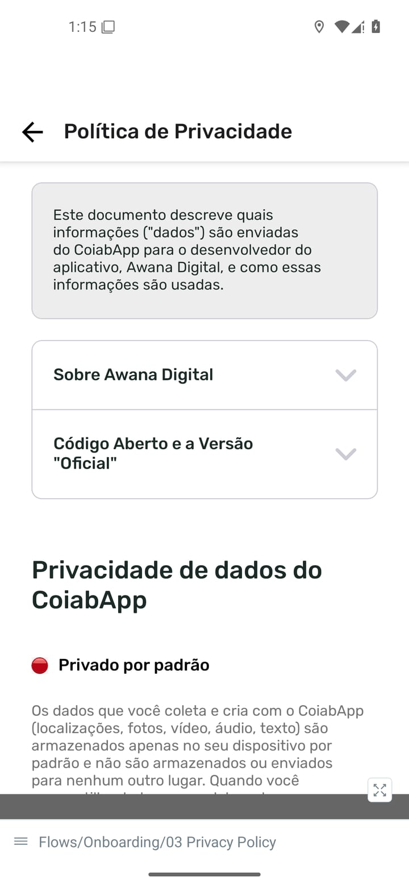

Role o documento até o fim. Em **Permissões atuais** você pode ligar ou desligar
o envio de informações de diagnóstico. Use a seta de voltar no topo para
retornar e siga em **Próximo**.

:::note[ℹ️ Nota]
O app não pede câmera nem localização na abertura: cada permissão é pedida quando
o recurso é usado pela primeira vez — a câmera ao tirar uma foto e a localização
no mapa.
:::

### Passo 4 — Nome do dispositivo

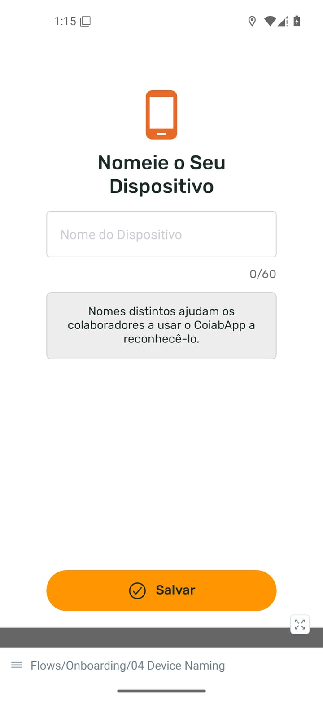

Digite um nome que identifique o aparelho para as outras pessoas — por exemplo,
o nome de quem vai usá-lo. Toque em **Salvar**; o nome pode ter até 60
caracteres.

### Passo 5 — Etnia (campo vazio)

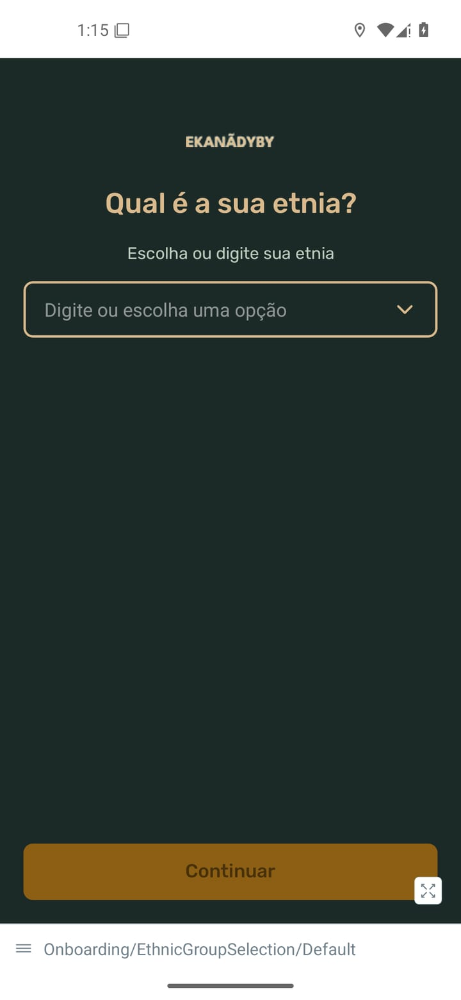

Digite ou escolha sua etnia no campo com a indicação **Digite ou escolha uma
opção**. Enquanto o campo estiver vazio, o botão **Continuar** fica desativado.

### Passo 6 — Etnia preenchida

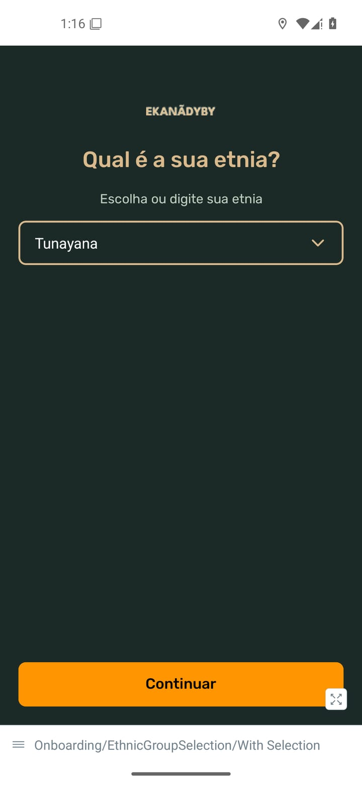

Com a etnia preenchida, toque em **Continuar** para ir à aldeia.

### Passo 7 — Sugestões de etnia

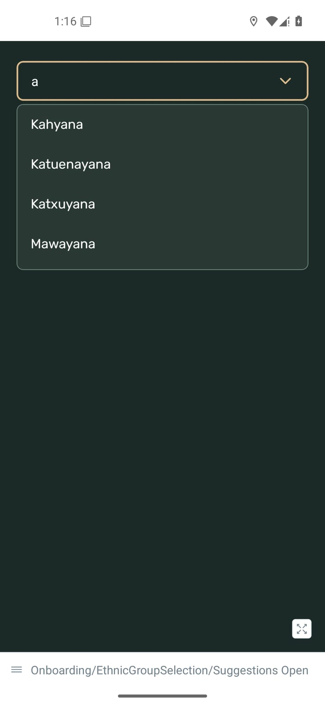

Ao digitar, o app mostra sugestões de etnia. Toque em uma delas para preencher o
campo sem digitar o nome inteiro.

### Passo 8 — Aldeia (campo vazio)

Repita o processo para a aldeia: digite ou escolha a sua no campo **Digite ou
escolha uma opção**.

:::caution[⚠️ Atenção]
Etnia e aldeia são obrigatórias nesta etapa e não voltam a ser pedidas depois.
Confira o texto antes de tocar em **Continuar**.
:::

### Passo 9 — Aldeia preenchida

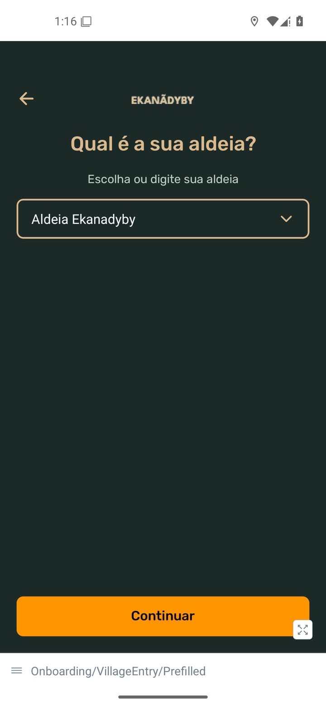

Com a aldeia escolhida, toque em **Continuar**. O app conclui a identificação do
dispositivo.

### Passo 10 — Tudo pronto

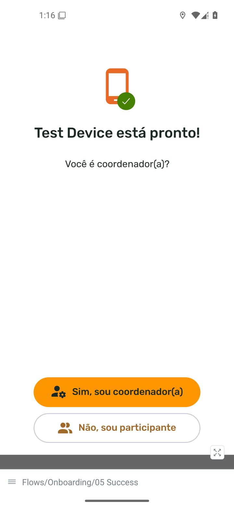

A tela confirma que o dispositivo está pronto e pergunta **Você é
coordenador(a)?** A resposta define o próximo caminho: quem coordena cria um
território; quem participa aguarda um convite.

### Passo 11 — Aguardar convite

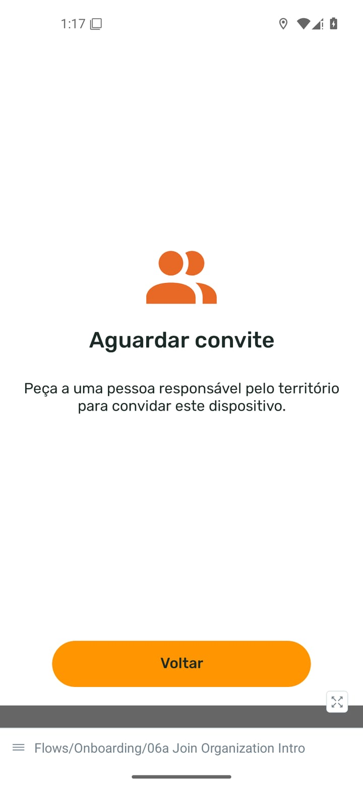

Se você tocou em **Não, sou participante**, o app mostra **Aguardar convite**.
Peça a uma pessoa responsável pelo território que convide este dispositivo. O
convite aparece no app quando chegar.

### Passo 12 — Criar território

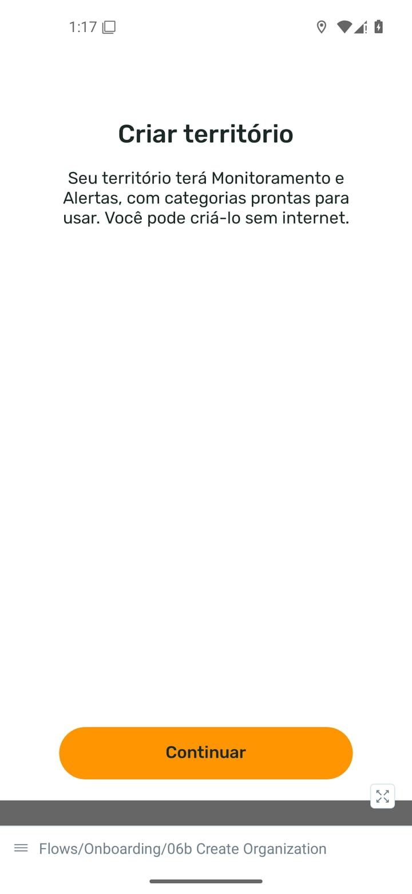

Se você tocou em **Sim, sou coordenador(a)**, o app abre a criação do território.
Toque em **Continuar** para escolher o nome e concluir a criação — o passo a passo
completo está em [Organização](../organizacao/).

:::tip[💡 Dica]
A tela de introdução diz que o território pode ser criado sem internet, mas a
versão atual exige um **Endereço do arquivo remoto** válido, conferido na hora: é
preciso estar conectado para concluir a criação. Veja os detalhes em
[Organização](../organizacao/). Já o convite entre dispositivos é diferente — os
dois aparelhos precisam estar na mesma rede Wi-Fi e na mesma versão do app.
:::

## Veja também

- [Organização](../organizacao/) — preparar o território, convidar e trocar.
- [Criar uma observação](../criar-observacao/) — o primeiro registro no mapa.
